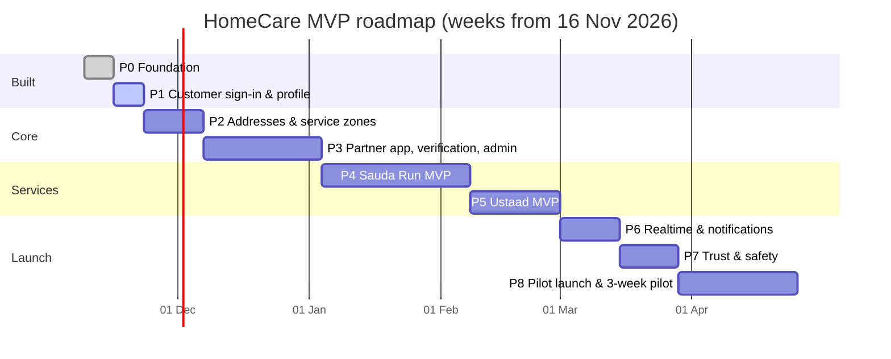

# HomeCare — Project Plan & Scope

_As of 2026-11-12. Living document: change it by pull request when the plan changes._

**The MVP is a cash-only pilot of Sauda Run (errands) and Ustaad (home repairs) in a few dense
Islamabad/Rawalpindi sectors, built in 8 phases over about 23 weeks.** Phase 1 (customer sign-in) is built;
it needs a test on a real phone to close.

Planning assumption: 3–4 team members working part-time (~15–20 h/week each). With fewer people or hours,
stretch the weeks; keep the order.

---

## 1. Roadmap at a glance

Each phase ends at a gate (the "done when" in section 4). We don't start a phase until the one it depends on
has passed its gate, except where the chart shows overlap.

| Phase | Weeks | Approx. dates | Gate (done when) |
| --- | --- | --- | --- |
| P0 Foundation | done | Nov 2026 | Monorepo, Supabase, GitHub in place ✅ |
| P1 Customer sign-in & profile | 1 | to 22 Nov 2026 | New number signs up on a real phone and stays signed in after restart |
| P2 Addresses & service zones 🚧 | 2 | to 6 Dec 2026 | Customer saves an address by map pin; outside-zone address is refused |
| P3 Partner app, verification, admin 🚧 | 4 | to 3 Jan 2027 | A rider and an ustaad register, get approved in admin, and go online |
| P4 Sauda Run MVP 🚧 | 5 | to 7 Feb 2027 | 10 test errands completed end to end, cash settled |
| P5 Ustaad MVP | 3 | to 28 Feb 2027 | 10 test jobs completed with quote → approve → done |
| P6 Realtime & notifications | 2 | to 14 Mar 2027 | Status changes arrive as push within 5 s; live rider location on map |
| P7 Trust & safety | 2 | to 28 Mar 2027 | SOS, share-trip and disputes work; admin can suspend a partner |
| P8 Pilot launch & pilot | 4 | to 25 Apr 2027 | 3-week pilot run; pilot metrics (section 8) measured |

---

## 2. Scope

### In scope (MVP pilot)

| Area | Included |
| --- | --- |
| Area served | Pilot sectors only, e.g. G-9/G-10/G-11, F-10/F-11, Bahria Town Ph. 1–8, Saddar/Satellite Town (final list = decision D1) |
| Sauda Run | Free-form list (text, photo, voice note as audio), categories (sabzi, grocery, pharmacy, bakery, meat, food pickup, pick & drop), preferred shop or "nearest", substitution chat, bill photo, item cost + fixed delivery fee |
| Ustaad | 4 trades: plumber, electrician, AC technician, mechanic; "come now" or scheduled; problem photos; visit fee → quote → approve; parts listed separately; 7-day warranty revisit; favourite ustaad |
| Accounts | Phone OTP sign-in for customers and partners; profiles; saved addresses; book for someone else (address with recipient name/phone) |
| Partners | Self-registration, CNIC front/back + selfie, admin approval, online/offline, location while online, earnings screen |
| Admin | Approve partners, view orders, manual dispatch, suspend partners, resolve disputes |
| Payments | Cash only (rider fronts item cost; customer pays on delivery) |
| Languages | English and Urdu |
| Platform | Android first (customer + partner apps); admin is a web app |

### Out of scope for the MVP (later phases)

| Item | When |
| --- | --- |
| JazzCash / Easypaisa / Raast, wallet, card payments | Phase 2 (after pilot) |
| Urdu voice-to-list AI, photo fault diagnosis | Phase 2 |
| Recurring orders (weekly sabzi, monthly tank cleaning), subscriptions | Phase 2 |
| More trades (carpenter, painter, appliance repair, solar/generator) | Phase 2 |
| New verticals (cleaning, water tank, tanker, LPG, bill payments, elderly assist, laundry) | Phase 2 |
| Price reference board, "mohalla trust" social proof | Phase 2 |
| iOS release | Phase 2 |
| Lahore/Karachi, B2B, tutors, pest control | Phase 3 |
| Own inventory or dark stores | Not planned (asset-light: we move people, not stock) |

---

## 3. Apps and users

| Part | Folder | Used by | Does |
| --- | --- | --- | --- |
| Customer app | `apps/mobile` | Households | Sign in, addresses, place errands and bookings, track, chat, pay cash, rate |
| Partner app | `apps/partner` (P3) | Riders and ustaads | Register, verification, go online, accept jobs, update status, upload bill/quote, see earnings |
| Admin panel | `apps/admin` (P3) | Our ops team | Approve partners, watch live orders, dispatch by hand, handle disputes |
| Backend | Supabase + `apps/api` | All apps | Auth, database + security rules, files, realtime (Supabase); dispatch, pricing, order rules (NestJS, from P4) |

Rule of thumb: **if a client could cheat by doing it (price, who gets the job, order status), it goes through
NestJS or a database function, never a direct table write from an app.**

---

## 4. Phases in detail

Status: ✅ done · 🚧 in progress · ⬜ not started. Tick the boxes in pull requests as work lands.

### P0 Foundation ✅
- [x] Monorepo (npm workspaces), Expo app, NestJS API, GitHub repo
- [x] Supabase project (Mumbai region), env files, setup guide

### P1 Customer sign-in & profile 🚧 (1 week)
**Goal:** a customer can sign in with their phone number and set up a profile.
- [x] Phone OTP sign-in, profile setup, Home/Orders/Account tabs, edit profile
- [x] English + Urdu, light/dark, UI kit
- [x] `profiles` table with security rules (tested)
- [ ] Run on a real Android phone with a Supabase test number
- [ ] Each team member signs in on their own phone

**Done when:** a new number signs up on a real phone, closes the app, reopens it and is still signed in.

### P2 Addresses & service zones 🚧 (2 weeks)
**Goal:** we know exactly where the customer is and whether we serve it.
- [x] `addresses` table (PostGIS point, label Home/Work/Parents/Other, house/street/sector, landmark, directions, recipient name/phone) with security rules (tested)
- [x] `service_zones` (approximate pilot circles), `check_service_area`, coverage overlay; outside a zone → "not in your area yet" + waitlist
- [x] Home: full-screen map + collapsible sheet (service tiles, delivery address, saved places)
- [x] Map pin picker with place search and "use my location"; address form; saved addresses list (select / edit / default / delete)
- [x] Book for someone else (address with a different recipient)
- [ ] Run `SETUP_02` on Supabase and test on a real phone
- [ ] Replace the approximate circles with drawn sector polygons once D1 is decided

Maps: MapLibre + free OpenStreetMap tiles (OpenFreeMap), no API key. Address lookup: Nominatim (free,
fair use: 1 request/s, search on submit). Both sit behind one file each, so switching to Google or a
paid geocoder later only touches `features/map/app-map.tsx` or `features/location/geocoding.ts`.

**Done when:** a customer saves an address by map pin, sees it on Home, and an address outside the zone is refused with the waitlist option.

### P3 Partner app, verification & admin 🚧 (4 weeks)
**Goal:** riders and ustaads can register, get verified and go online. Without supply nothing else matters.
- [x] `packages/shared`: UI kit, theme, translations, Supabase client, sign-in screens, map, location shared by all apps
- [x] `apps/partner`: reuses the sign-in flow; choose Rider or Ustaad (+ trades)
- [x] CNIC front/back + selfie upload to a private storage bucket (own folder only; admins read all)
- [x] Rider: vehicle type/number; payout number (JazzCash/Easypaisa) for later
- [x] Status: draft → pending → approved / rejected (with reason) → suspended; enforced by database functions (tested)
- [x] Online/offline toggle; location update every 15 s while online and the app is open
- [x] `apps/admin` (web): applications queue, document viewer, approve/reject/suspend, live map of online partners
- [ ] Run `SETUP_03` on Supabase, add the first admin, test both apps on real phones
- [ ] Background location while the phone is locked (with dispatch in P4/P6)
- [ ] Partner app on low-end Android and weak data (test on a cheap phone)
- [ ] Host the admin panel (Vercel/Netlify free tier)

**Done when:** a rider and an ustaad register on their phones, an admin approves them, and they appear on the admin live map when online.

### P4 Sauda Run MVP 🚧 (5 weeks)
**Goal:** the first real errand, end to end, cash only.

Slice 1 (done):
- [x] Business settings in the database with provisional values for D3–D8 (admins edit them in the admin panel)
- [x] Orders, status history, private order photos; every change goes through database functions (tested)
- [x] Customer: New Sauda Run (category, list, up to 4 list photos, preferred shop, address, directions), order status with progress, rider call button, payment breakdown, bill photo, cancel (free → fee), rating
- [x] Rider: nearby open orders (first to accept gets it), one active order at a time, steps: at shop (final fee from distance) → bill amount + photo (cash limit) → on the way → delivered & cash collected; give back before reaching the shop
- [x] Admin: orders list with history, assign to a rider (manual dispatch), cancel with reason; settings editor
- [x] Account deletion in both apps; Terms of Service and Privacy Policy (draft) in the apps and on a public website

Slice 2 (done, `SETUP_05`):
- [x] Substitution questions from the shop ("no Olpers, get Nestle?" with optional price and photo); the customer answers yes/no; unanswered ones close as "no answer" when the rider leaves
- [x] Voice note for the list (up to 2 minutes; the written list becomes optional)
- [x] Automatic one-by-one offers to the nearest free online rider (30 s each, 3 riders), then the nearby list and "Needs a rider" in the admin panel. Built in the database (no server needed); a 10-second pg_cron timer when available
- [x] Customer sees the rider on a map (location every 15 s) and updates arrive live (Supabase Realtime), with a 15 s refresh as backup
- [x] Push notifications: phones register, the database queues messages, the API sends them through Firebase (needs a Firebase project; see `docs/PUSH_NOTIFICATIONS.md`)

Next:
- [ ] Run `SETUP_04` and `SETUP_05` on Supabase; build both APKs and run a test errand on two phones
- [ ] Firebase project + host the API so push notifications reach phones
- [ ] NestJS verifying Supabase logins (for future trusted endpoints)
- [ ] Background location while the rider's phone is locked

**Done when:** the team completes 10 test errands in the pilot sectors with real money and no manual database fixes.

### P5 Ustaad MVP ⬜ (3 weeks)
**Goal:** home repair bookings, reusing P4's dispatch, states and ratings.
- [ ] Trades: plumber, electrician, AC technician, mechanic
- [ ] Book "come now" (surge fee) or a scheduled slot; problem photos/video
- [ ] Visit fee → ustaad sends quote in-app (labour + parts) → customer approves → work → done
- [ ] 7-day warranty: "issue came back" creates a free revisit job
- [ ] Favourite ustaad; rebook the same person

**Done when:** 10 test jobs go through visit → quote → approve → complete, including one warranty revisit.

### P6 Realtime & notifications 🚧 (2 weeks)
- [x] Push notifications for every Sauda Run status change (code done in P4 slice 2; needs Firebase + hosted API to go live)
- [x] Rider location on the customer's map, live order updates (Supabase Realtime)
- [ ] Same for Ustaad jobs (P5)
- [ ] In-app chat per order
- [ ] SMS fallback for job offers to partners with weak data

**Done when:** status changes reach the customer as a push within 5 seconds, and chat works both ways.

### P7 Trust & safety ⬜ (2 weeks)
- [ ] SOS button; share live trip/job with family
- [ ] Female-customer preference setting
- [ ] Disputes: raise an issue on an order, admin notes, adjustment recorded
- [ ] Partner suspension; ratings moderation

**Done when:** a test dispute is raised and resolved in admin, and a suspended partner can no longer go online.

### P8 Pilot launch & pilot ⬜ (4 weeks: 1 week prep, 3 weeks pilot)
- [ ] 20–30 verified ustaads and 15–20 riders onboarded in pilot sectors **before** customers are invited
- [ ] Real SMS provider (Twilio or a Pakistani gateway via Send SMS Hook); remove test numbers
- [ ] Play Store internal → closed testing; crash reporting (Sentry); basic analytics
- [ ] Terms of service, privacy policy, CNIC data handling policy; business registration
- [ ] Run the pilot; weekly review of the metrics in section 8

**Done when:** the 3-week pilot has run and the section 8 metrics are measured.

---

## 5. Decisions to make

Business rules the code depends on. Each must be decided before the phase that needs it starts.
D3–D8 now have **provisional values** in the database (`app_settings`, editable in the admin panel → Settings);
the app works with them until the team confirms or changes them.

| # | Decision | Needed by | Starting proposal |
| --- | --- | --- | --- |
| D1 | Exact pilot sectors | P2 | 4–6 dense sectors where we can recruit partners |
| D2 | One app for riders and ustaads, or two | P3 | One partner app with a role choice |
| D3 | Delivery fee bands | P4 | e.g. Rs 150 up to 3 km, Rs 250 up to 6 km |
| D4 | Max order value a rider fronts in cash | P4 | e.g. Rs 5,000; above that, customer pays the shop directly |
| D5 | Commission per job | P4 | e.g. 10–15% of delivery fee / labour |
| D6 | Cancellation rules and fees | P4 | Free until accepted; small fee after rider reaches the shop |
| D7 | Ustaad visit fee and "come now" surge | P5 | e.g. Rs 500 visit fee, credited if the job goes ahead |
| D8 | Warranty terms | P5 | Labour only, 7 days, same issue |
| D9 | SMS provider for launch | P8 | Pakistani gateway via Send SMS Hook (cheaper than Twilio) |
| D10 | Partner payout schedule | P8 | Daily (cash model: partners keep cash, we collect commission weekly) |

---

## 6. Team and way of working

| Role | Owns |
| --- | --- |
| Customer app | `apps/mobile` screens, UI kit, translations |
| Backend | Supabase schema + security rules, `apps/api`, tests |
| Partner app + admin | `apps/partner`, `apps/admin` (from P3) |
| Product & ops (shared) | User interviews, partner recruitment, pilot operations, decisions in section 5 |

- **Branches:** one per feature, e.g. `feat/p2-addresses`; pull request into `main`; at least one reviewer.
- **Database changes:** a new file in `supabase/migrations` + a matching update to the SQL editor script; `npm run db:test` must pass.
- **Before a PR:** `npm run typecheck`, `npm run lint`, `npm run db:test`, `npm run api:test`.
- **Secrets:** never in Git. Share `.env` values privately.
- **Rhythm:** a short weekly sync — what passed its gate, what's blocked, which decision is due next.
- **Definition of done** for any feature: works on a real Android phone, in English and Urdu, handles no-internet with a clear message, and has tests where logic or security is involved.

---

## 7. Risks

| Risk | Impact | How we reduce it |
| --- | --- | --- |
| Not enough riders/ustaads at launch | "No one available" on day one; users don't return | Recruit supply first (P8 checklist); launch in few sectors only |
| Partners take customers offline | Lost revenue | Low commission, daily payouts, repeat-booking with the same ustaad inside the app |
| Customers don't trust strangers at home | Low bookings | CNIC + selfie verification badge, ratings, share-trip, SOS |
| Price disputes (items, repairs) | Bad reviews, refunds | Bill photo, in-app quote approval before work, parts listed separately |
| Weak data / low-end phones | Missed jobs | Light partner app, SMS fallback for offers, offline-friendly screens |
| SMS cost for OTP | Running cost | Test numbers in development; Pakistani SMS gateway via Send SMS Hook |
| Scope creep (new verticals too early) | Pilot slips | Anything not in section 2 waits for Phase 2; changes to scope go through this document |
| Handling CNIC images | Legal/privacy risk | Private storage, admin-only access, retention policy before launch |

---

## 8. Pilot success

| Metric | Target for the 3-week pilot |
| --- | --- |
| Completed orders + jobs | 100+ |
| Time from order to partner accepting | Median under 5 minutes |
| Completion rate (not cancelled/failed) | 85%+ |
| Customers who order again within the pilot | 30%+ |
| Average rating of partners | 4.5 / 5+ |
| Disputes | Under 5% of orders |

### Learn while we build
We have no usage data yet, so in parallel with P1–P3:
- Interview about 10 households and 10 ustaads/riders in the pilot sectors: what they order, what they pay, what goes wrong today.
- Run a 1–2 week manual "WhatsApp concierge" trial (orders by WhatsApp, dispatched by hand) before P4 starts. It shows real order shapes, prices and failure cases before we hard-code them.
